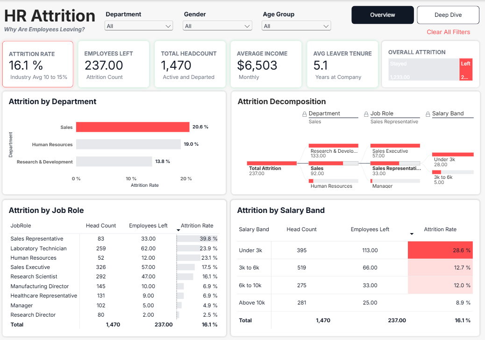
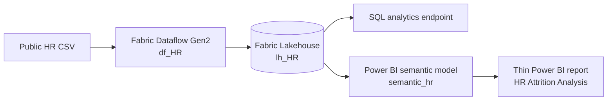
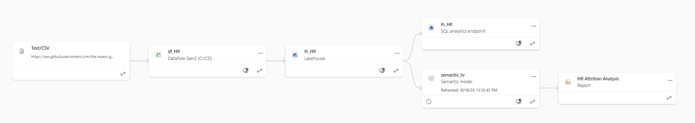
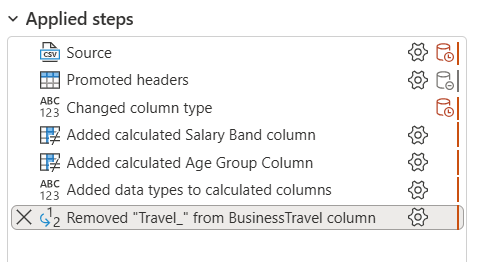
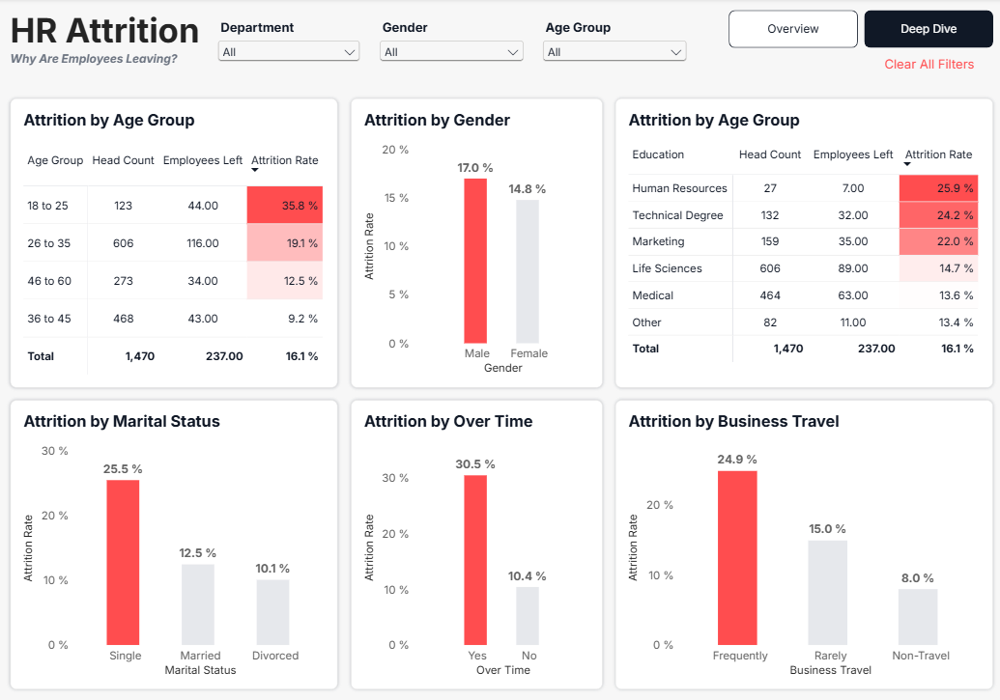
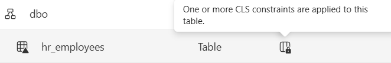

# HR Attrition Analysis with Microsoft Fabric & Power BI


An end-to-end HR analytics project that turns a 1,470-row employee snapshot into a decision-ready Power BI report. The solution uses a Microsoft Fabric Dataflow Gen2, a Lakehouse, a shared semantic model, reusable DAX measures, column-level security on the reporting table, and a source-controlled Power BI Project (PBIP) report.



## Project overview

The objective was to help HR leaders understand where employee attrition is concentrated and which workforce characteristics warrant deeper investigation. The report answers five practical questions:

- What is the overall attrition rate, and how many employees left or stayed?
- Which departments and job roles have the highest attrition rates?
- How does attrition vary by salary band, age group, gender, and education field?
- Are overtime, marital status, or business travel associated with higher attrition?
- Can users isolate a workforce segment and explore the same metrics consistently across the report?

The finished report contains an executive **Overview** and a diagnostic **Deep Dive** page. Department, gender, and age-group slicers, cross-filtering, page navigation, and clear-filter actions support guided exploration.

## Results at a glance

| Metric | Result |
|---|---:|
| Employee records | 1,470 |
| Unique employee numbers | 1,470 |
| Employees who left | 237 |
| Employees who stayed | 1,233 |
| Attrition rate | 16.1% |
| Average monthly income | $6,503 |
| Average tenure of leavers | 5.1 years |
| Source / curated columns | 35 / 37 |

The Dataflow retains every source record. Preparation standardizes business-travel labels and adds two analytical groupings: `Salary Band` and `Age Group`.

### Business insights

- **Overtime is the strongest displayed differentiator:** employees working overtime have a 30.5% attrition rate, compared with 10.4% for employees who do not—almost three times as high.
- **Early-career employees are most exposed:** the 18–25 age group has a 35.8% attrition rate, versus 9.2% for employees aged 36–45.
- **Lower-paid employees leave more often:** the `Under 3k` salary band records 28.6% attrition, compared with 8.9% for `Above 10k`.
- **Sales Representative is the highest-rate role:** 33 of 83 employees left, producing a 39.8% attrition rate. Of those 33 departures, 28 are in the `Under 3k` band.
- **Travel frequency matters:** frequent travelers show 24.9% attrition, compared with 15.0% for rare travelers and 8.0% for non-travelers.
- **Sales leads the departments:** Sales has a 20.6% attrition rate, followed by Human Resources at 19.0% and Research & Development at 13.8%.

These are descriptive associations in a static sample. They identify where to investigate; they do not establish why an employee left or prove causation.

## Solution architecture



The Fabric lineage view confirms the implemented path from the hosted text/CSV source through Dataflow Gen2 and the Lakehouse to the shared semantic model and report.



| Component | Purpose | Main output |
|---|---|---|
| Hosted CSV | Supplies the employee snapshot | 1,470 rows and 35 source fields |
| Dataflow Gen2 (`df_HR`) | Applies repeatable Power Query transformations | Typed and enriched employee data |
| Lakehouse (`lh_HR`) | Stores the reporting table and exposes a SQL endpoint | `hr_employees` |
| Semantic model (`semantic_hr`) | Centralizes DAX measures and security | Shared HR metrics |
| Power BI report | Presents interactive analysis | Overview and Deep Dive pages |

## Data preparation

The Dataflow Gen2 applies the following steps:

1. Connect to the CSV source and promote the first row to headers.
2. Assign data types to the source fields.
3. Add a calculated `Salary Band` column: `Under 3k`, `3k to 6k`, `6k to 10k`, or `Above 10k`.
4. Add a calculated `Age Group` column: `18 to 25`, `26 to 35`, `36 to 45`, or `46 to 60`.
5. Assign data types to the calculated columns.
6. Remove the `Travel_` prefix from `BusinessTravel`, producing `Rarely`, `Frequently`, and `Non-Travel`.



The repository includes before-and-after validation extracts:

- [`bronze_hr_employees.csv`](data/bronze_hr_employees.csv) — the 35-column source snapshot;
- [`silver_hr_employees.csv`](data/silver_hr_employees.csv) — the 37-column prepared snapshot used to validate the report baseline.

Both files contain 1,470 records and 1,470 unique employee numbers. The curated extract has no blank fields, while `EmployeeCount`, `Over18`, and `StandardHours` are constant source columns and therefore add no segmentation value.

## Semantic model and DAX

The report is a thin report with a read-only connection to the Fabric/Power BI semantic model `semantic_hr`. The model exposes a single employee-grain table, `hr_employees`, and six report measures:

```DAX
Employees Left =
CALCULATE(
    COUNTROWS(hr_employees),
    hr_employees[Attrition] = "Yes"
)

Employees Stayed =
CALCULATE(
    COUNTROWS(hr_employees),
    hr_employees[Attrition] = "No"
)

Attrition Rate =
DIVIDE(
    CALCULATE(
        COUNTROWS(hr_employees),
        hr_employees[Attrition] = "Yes"
    ),
    COUNTROWS(hr_employees)
)

Avg Tenure of Leavers =
CALCULATE(
    AVERAGE(hr_employees[YearsAtCompany]),
    hr_employees[Attrition] = "Yes"
)
```

`Head Count` and `Average Monthly Income` complete the measure set. Their current DAX uses `FORMAT`, so they return display text; a production model should keep them numeric and apply model-level format strings instead.

## Dashboard design

### Overview

The Overview page combines:

- KPI cards for attrition rate, employees left, total headcount, average monthly income, and average tenure of leavers;
- an overall stayed-versus-left treemap;
- attrition rate by department;
- an interactive decomposition tree across department, job role, and salary band;
- detailed job-role and salary-band matrices; and
- department, gender, and age-group slicers.

### Deep Dive



The Deep Dive page compares attrition by:

- age group;
- gender;
- education field;
- marital status;
- overtime status; and
- business-travel frequency.

Both pages use a consistent high-contrast theme, page navigation, clear-filter actions, and configured visual interactions. Red highlights higher-risk segments while neutral gray provides comparison context.

## Security and governance

The `hr_employees` table is marked with one or more column-level security (CLS) constraints in Fabric’s table/SQL access layer.



The repository does not contain the service-side CLS definitions, so the protected columns, role membership, and end-to-end behavior through the semantic model must be verified in the Fabric/Power BI workspace before production use. Workspace permissions and the report’s read-only semantic-model connection provide additional access boundaries.

## Repository structure

```text
hr-attrition-dashboard/
├── data/                    # Bronze and prepared employee CSV snapshots
├── docs/
│   └── BRD.md               # Business Requirements Document
├── powerbi/                 # PBIP project pointer
├── screenshots/             # Report, lineage, transformation, security, and DAX evidence
├── semantic_model/
│   └── HR Attrition Analysis.Report/  # Source-controlled PBIR report definition
├── HR_Attrition_Theme.json  # Reusable report theme source
└── README.md
```

## Explore the project

### Review without Fabric access

1. Open the Overview and Deep Dive screenshots above.
2. Inspect the prepared data in [`data/`](data/).
3. Review the report’s declarative PBIR files in [`semantic_model/HR Attrition Analysis.Report/`](semantic_model/HR%20Attrition%20Analysis.Report/).
4. Read the detailed requirements and validation baseline in [`docs/BRD.md`](docs/BRD.md).

### Open the connected report

1. Install a compatible version of Power BI Desktop with PBIP/PBIR support.
2. Open [`powerbi/HR Attrition Analysis.pbip`](powerbi/HR%20Attrition%20Analysis.pbip).
3. If the project cannot locate its report folder in this repository layout, change the PBIP report path to `../semantic_model/HR Attrition Analysis.Report` or place the report folder beside the PBIP file.
4. Sign in to the Power BI tenant that hosts the `semantic_hr` semantic model.

> [!NOTE]
> The report definition uses a tenant-hosted semantic-model connection. The screenshots and CSV extracts remain fully reviewable without tenant access, but interactive refresh and model inspection require authorization to the original workspace.

### Reproduce the Fabric workflow

1. Create a Fabric workspace, Lakehouse, and Dataflow Gen2.
2. Connect the Dataflow to the source CSV or upload [`bronze_hr_employees.csv`](data/bronze_hr_employees.csv).
3. Recreate the applied steps listed in **Data preparation** and load the output as `hr_employees`.
4. Build the six measures shown in [`screenshots/`](screenshots/) and apply the required CLS rules at the governed Fabric data-access layer.
5. Connect the supplied report definition to the new semantic model and validate the totals in **Results at a glance**.

## Limitations

- The data is a static, cross-sectional employee snapshot with no event date, so the report cannot show attrition trends or calculate time-to-exit.
- The report supports descriptive analysis, not causal inference or employee-level attrition prediction.
- The displayed “Industry Avg 10 to 15%” text is a static contextual benchmark, not a calculated KPI or cited external reference.
- Semantic-model definitions and detailed CLS rules are hosted in the service and are not fully version-controlled in this repository.
- The external CSV source and tenant-hosted semantic model are runtime dependencies unless replaced with local equivalents.

## Skills demonstrated

`Microsoft Fabric` · `Dataflow Gen2` · `Power Query` · `Lakehouse` · `SQL Analytics Endpoint` · `Power BI` · `PBIP/PBIR` · `DAX` · `Data Cleaning` · `Semantic Modeling` · `Column-Level Security` · `Data Visualization` · `HR Analytics`
