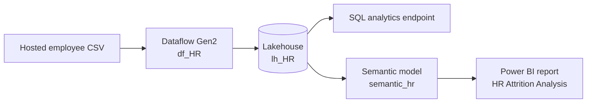

# Business Requirements Document: HR Attrition Analysis

| Document item | Value |
|---|---|
| Project | HR Attrition Analysis with Microsoft Fabric and Power BI |
| Document type | Business Requirements Document (BRD) |
| Version | 1.0 |
| Status | As-built baseline |
| Last updated | 18 October 2026 |
| Primary deliverable | Interactive two-page Power BI attrition report |

## 1. Executive summary

The HR Attrition Analysis project provides a single, interactive view of employee turnover patterns. It converts a hosted CSV employee snapshot into a prepared Fabric Lakehouse table through Dataflow Gen2, exposes reusable metrics through the `semantic_hr` semantic model, and presents the results in a source-controlled Power BI report.

The solution is intended for HR leadership, HR business partners, department leaders, and workforce analysts who need to understand overall attrition and compare outcomes across departments, job roles, salary bands, age groups, gender, education fields, marital status, overtime status, and business-travel frequency.

The current portfolio dataset contains 1,470 unique employee records. Of these, 237 are marked as having left and 1,233 as having stayed, producing an overall attrition rate of 16.1%. Average monthly income is $6,502.93, displayed as $6,503, and employees who left had an average company tenure of 5.13 years, displayed as 5.1.

## 2. Business context and problem statement

Employee data supplied as a flat CSV does not by itself provide consistent workforce metrics or an efficient way to identify high-attrition segments. HR users require shared definitions, repeatable preparation, interactive segmentation, and a concise view that distinguishes workforce size from employee departures and attrition rate.

The project must therefore:

- create a typed and analysis-ready employee dataset from the source extract;
- add consistent age and salary groupings for comparison;
- centralize headcount, leaver, stay, attrition-rate, income, and tenure logic;
- present an executive summary and a deeper diagnostic view;
- allow users to filter by core workforce attributes; and
- maintain visible lineage from the hosted source through Fabric to Power BI.

## 3. Business objectives

| ID | Objective | Intended business outcome |
|---|---|---|
| OBJ-01 | Establish a repeatable employee-data workflow | Reduce manual preparation and make transformations traceable. |
| OBJ-02 | Provide an executive attrition overview | Allow HR leaders to understand workforce size and attrition at a glance. |
| OBJ-03 | Compare organizational segments | Identify departments and job roles with elevated attrition. |
| OBJ-04 | Compare demographic and employment characteristics | Reveal groups that warrant further investigation or targeted retention analysis. |
| OBJ-05 | Support guided root-cause exploration | Let users decompose departures by department, role, and salary band. |
| OBJ-06 | Provide reusable business metrics | Ensure report visuals use common semantic-model measures. |
| OBJ-07 | Protect sensitive model data | Apply access controls appropriate to employee-level HR data. |

## 4. Business questions

The solution must answer the following questions:

1. What are the total headcount, employee departures, employee stays, and overall attrition rate?
2. What is the average monthly income of the selected workforce?
3. How long had departing employees worked at the company on average?
4. Which departments and job roles have the highest attrition rates?
5. How are departures distributed across department, job role, and salary band?
6. How does attrition vary by salary band and age group?
7. How does attrition vary by gender and education field?
8. Are overtime, marital status, and business-travel frequency associated with different attrition rates?
9. How do the results change when department, gender, or age group is selected?

## 5. Stakeholders and users

| Stakeholder or user | Primary need |
|---|---|
| HR executive or people leader | Review overall attrition and the most exposed workforce segments. |
| HR business partner | Explore department, role, compensation, and demographic patterns. |
| Department manager | Compare the selected department with broader workforce outcomes. |
| Compensation or workforce-planning analyst | Review salary-band, income, age, tenure, and role relationships. |
| Data analyst | Validate metrics, filters, and segment-level results. |
| Data engineer | Operate and troubleshoot the Dataflow Gen2 and Lakehouse load. |
| BI developer or semantic-model owner | Maintain DAX, report behavior, formats, and access controls. |
| Data owner or governance reviewer | Confirm data use, security, lineage, and appropriate interpretation. |

## 6. Scope

### 6.1 In scope

- Ingestion of a hosted employee CSV through Microsoft Fabric Dataflow Gen2.
- Header promotion, data typing, categorical enrichment, and text standardization in Power Query.
- Loading the prepared `hr_employees` table into a Fabric Lakehouse.
- Exposure of the Lakehouse through its SQL analytics endpoint and the `semantic_hr` semantic model.
- Six reusable DAX measures for headcount, leavers, stayers, attrition rate, average monthly income, and average tenure of leavers.
- Column-level security constraints on the employee table in Fabric’s governed data-access layer.
- A two-page thin Power BI report with KPI cards, matrices, charts, a decomposition tree, slicers, cross-filtering, navigation, and clear-filter actions.
- Source-controlled PBIR report definitions, a PBIP pointer, a custom theme, screenshots, and before/after CSV validation extracts.

### 6.2 Out of scope

- Attrition forecasting, machine-learning scoring, or prescriptive recommendations.
- Causal claims about why individual employees left.
- Attrition trends, seasonality, or period-over-period comparisons because the source contains no event date.
- Voluntary-versus-involuntary departure analysis.
- Recruitment, vacancy, absence, engagement-survey, performance-history, or succession analytics.
- Replacement cost, turnover cost, or financial impact calculations.
- Employee-level intervention workflows or write-back from the report.
- Real-time or streaming ingestion.
- A production service-level agreement, alerting process, or deployment pipeline.
- Row-level security by manager or department unless added in a later release.

## 7. Assumptions and constraints

- Each row represents one employee, and `EmployeeNumber` uniquely identifies that employee.
- `Attrition = "Yes"` means the employee left; `Attrition = "No"` means the employee stayed or is active in the snapshot.
- The file is a static cross-sectional snapshot rather than a history of workforce events.
- All 1,470 source records are eligible for analysis; no rows are removed by the current preparation process.
- `MonthlyIncome` is displayed as US dollars in the report, although the source extract does not include an explicit currency field.
- Salary bands use thresholds at 3,000, 6,000, and 10,000 and must assign every employee to exactly one band.
- Age groups are inclusive labeled ranges: 18–25, 26–35, 36–45, and 46–60.
- The displayed “Industry Avg 10 to 15%” text is static context, not a model calculation or validated external benchmark.
- The semantic model is hosted in the Power BI service/Fabric and is referenced by the report through a read-only connection.
- Detailed semantic-model metadata and CLS role definitions are not included in the local repository.
- `EmployeeCount`, `Over18`, and `StandardHours` are constant in the supplied dataset and are not useful report dimensions.

## 8. Solution overview

| Layer | Business purpose | Main output |
|---|---|---|
| Source | Supply the employee snapshot | CSV with 1,470 rows and 35 columns |
| Preparation | Standardize types and create reporting groups | Dataflow Gen2 `df_HR` |
| Storage | Persist the prepared employee table | Lakehouse `lh_HR`, table `hr_employees` |
| Access | Support SQL inspection and controlled table access | Lakehouse SQL analytics endpoint |
| Semantic | Centralize measures and security | `semantic_hr` |
| Presentation | Enable interactive HR analysis | Overview and Deep Dive report pages |
| Repository evidence | Make the portfolio project reviewable | CSV extracts, PBIR, screenshots, theme, and BRD |

## 9. Functional requirements

### 9.1 Ingestion and preparation

| ID | Requirement | Priority | Implemented by |
|---|---|---:|---|
| FR-01 | The solution shall connect to a header-based employee CSV source. | Must | Dataflow Gen2 `df_HR` |
| FR-02 | The solution shall promote the first source row to column headers. | Must | Power Query step `Promoted headers` |
| FR-03 | The solution shall assign appropriate data types to all source columns. | Must | Power Query step `Changed column type` |
| FR-04 | The solution shall add a `Salary Band` field with four mutually exclusive labels. | Must | Calculated Dataflow column |
| FR-05 | The solution shall add an `Age Group` field with four mutually exclusive labels. | Must | Calculated Dataflow column |
| FR-06 | The solution shall type both calculated fields for downstream use. | Must | Power Query calculated-column type step |
| FR-07 | The solution shall remove `Travel_` from `BusinessTravel` values while retaining `Non-Travel`. | Must | Power Query text replacement |
| FR-08 | The solution shall preserve all valid source employee rows and load the prepared result to `hr_employees`. | Must | Dataflow Gen2 / Lakehouse |
| FR-09 | The repository shall retain before-and-after extracts for independent validation. | Should | `data/bronze_hr_employees.csv`, `data/silver_hr_employees.csv` |

### 9.2 Semantic model and analytics

| ID | Requirement | Priority |
|---|---|---:|
| FR-10 | The semantic model shall expose the employee-grain `hr_employees` table. | Must |
| FR-11 | `Head Count` shall represent the number of employee rows in the current filter context. | Must |
| FR-12 | `Employees Left` shall count rows where `Attrition = "Yes"`. | Must |
| FR-13 | `Employees Stayed` shall count rows where `Attrition = "No"`. | Must |
| FR-14 | `Attrition Rate` shall divide employees left by headcount and respond to filter context. | Must |
| FR-15 | `Average Monthly Income` shall average `MonthlyIncome` for the selected workforce. | Must |
| FR-16 | `Avg Tenure of Leavers` shall average `YearsAtCompany` only for rows where `Attrition = "Yes"`. | Must |
| FR-17 | Semantic measures shall be reused across cards, matrices, charts, and decomposition visuals. | Must |
| FR-18 | One or more CLS constraints shall protect approved columns exposed through Fabric’s governed table/SQL access layer. | Must for controlled use |
| FR-19 | The report shall connect to `semantic_hr` in read-only mode. | Must |

### 9.3 Report and interaction requirements

| ID | Requirement | Priority |
|---|---|---:|
| FR-20 | The report shall provide separate Overview and Deep Dive pages. | Must |
| FR-21 | The Overview page shall display attrition rate, employees left, headcount, average income, and average leaver tenure. | Must |
| FR-22 | The Overview page shall compare stayed and departed employees. | Must |
| FR-23 | The Overview page shall compare attrition by department, job role, and salary band. | Must |
| FR-24 | The Overview page shall provide a decomposition path from department to job role to salary band. | Should |
| FR-25 | The Deep Dive page shall compare attrition by age group, gender, education field, marital status, overtime, and business travel. | Must |
| FR-26 | Both pages shall provide department, gender, and age-group slicers. | Must |
| FR-27 | Users shall be able to navigate between the two pages without using the Power BI page tabs. | Should |
| FR-28 | Users shall be able to clear all slicers on the active page with one action. | Should |
| FR-29 | Configured analytical visuals shall cross-filter applicable visuals on the same page. | Must |
| FR-30 | Higher-risk values shall be visually distinguishable without obscuring labels or totals. | Should |

## 10. Data requirements

### 10.1 Grain and identifiers

- Grain: one row per employee snapshot record.
- Business identifier: `EmployeeNumber`.
- Attrition indicator: `Attrition` with expected values `Yes` and `No`.
- Source size: 1,470 rows and 35 columns.
- Prepared size: 1,470 rows and 37 columns.

### 10.2 Required analytical attributes

The report requires the following groups of fields:

| Category | Fields |
|---|---|
| Organizational | `Department`, `JobRole`, `JobLevel` |
| Demographic | `Age`, `Age Group`, `Gender`, `MaritalStatus`, `Education`, `EducationField` |
| Compensation | `MonthlyIncome`, `Salary Band`, `DailyRate`, `HourlyRate`, `MonthlyRate`, `PercentSalaryHike`, `StockOptionLevel` |
| Work pattern | `OverTime`, `BusinessTravel`, `DistanceFromHome`, `WorkLifeBalance`, `JobInvolvement` |
| Experience and tenure | `TotalWorkingYears`, `YearsAtCompany`, `YearsInCurrentRole`, `YearsSinceLastPromotion`, `YearsWithCurrManager`, `NumCompaniesWorked`, `TrainingTimesLastYear` |
| Satisfaction and performance | `EnvironmentSatisfaction`, `JobSatisfaction`, `RelationshipSatisfaction`, `PerformanceRating` |

### 10.3 Data-quality rules

- `EmployeeNumber` must be populated and unique.
- `Attrition` must be either `Yes` or `No`.
- Numeric measures and scoring fields must parse successfully.
- Every employee must receive one valid age group and one valid salary band.
- `BusinessTravel` must contain only `Frequently`, `Rarely`, or `Non-Travel` after preparation.
- Prepared row count must reconcile to source row count for the current no-filter transformation process.
- Blank or unexpected values must be detected before refresh publication.

## 11. Business rules and calculation logic

| Rule | Definition |
|---|---|
| Employee headcount | Count of rows in the current filter context. |
| Employee left | A row whose `Attrition` value is `Yes`. |
| Employee stayed | A row whose `Attrition` value is `No`. |
| Attrition rate | Employees left divided by total headcount in the same filter context. |
| Salary band | One of `Under 3k`, `3k to 6k`, `6k to 10k`, or `Above 10k`, based on `MonthlyIncome`. |
| Age group | One of `18 to 25`, `26 to 35`, `36 to 45`, or `46 to 60`, based on `Age`. |
| Average income | Arithmetic mean of `MonthlyIncome` in the current filter context. |
| Average leaver tenure | Arithmetic mean of `YearsAtCompany` after applying `Attrition = "Yes"`. |
| Business travel label | Source values `Travel_Rarely` and `Travel_Frequently` become `Rarely` and `Frequently`; `Non-Travel` remains unchanged. |

## 12. KPI definitions

| KPI | Business definition | Current semantic-model calculation |
|---|---|---|
| Head Count | Number of employees in the current filter context | `FORMAT(COUNTROWS(hr_employees), "#,##0")` |
| Employees Left | Count of employees whose attrition flag is Yes | `CALCULATE(COUNTROWS(hr_employees), hr_employees[Attrition] = "Yes")` |
| Employees Stayed | Count of employees whose attrition flag is No | `CALCULATE(COUNTROWS(hr_employees), hr_employees[Attrition] = "No")` |
| Attrition Rate | Departed employees divided by total employees | `DIVIDE(CALCULATE(COUNTROWS(hr_employees), hr_employees[Attrition] = "Yes"), COUNTROWS(hr_employees))` |
| Average Monthly Income | Mean monthly income for the selected employees | `FORMAT(AVERAGE(hr_employees[MonthlyIncome]), "$#,##0")` |
| Avg Tenure of Leavers | Mean years at company among departed employees | `CALCULATE(AVERAGE(hr_employees[YearsAtCompany]), hr_employees[Attrition] = "Yes")` |

> **Modeling note:** `Head Count` and `Average Monthly Income` currently use `FORMAT`, which returns text. A production model should return numeric values and apply semantic-model format strings so sorting, conditional formatting, and downstream reuse remain numeric.

## 13. Report requirements

### 13.1 Overview page

| Area | Visual or control | Required analysis |
|---|---|---|
| Executive KPIs | Five cards | Attrition rate, employees left, headcount, average income, average leaver tenure |
| Overall outcome | Treemap | Employees stayed versus employees left |
| Department | Horizontal bar chart | Attrition rate by department |
| Diagnostic path | Decomposition tree | Employees left by department, job role, and salary band |
| Job role | Matrix | Headcount, employees left, and attrition rate by job role |
| Salary | Matrix | Headcount, employees left, and attrition rate by salary band |
| Filters | Three dropdown slicers | Department, gender, and age group |
| Navigation | Page navigator | Overview and Deep Dive |
| Reset | Clear-slicers button | Restore all page slicers to their unfiltered state |

### 13.2 Deep Dive page

| Area | Visual or control | Required analysis |
|---|---|---|
| Age | Matrix | Headcount, employees left, and attrition rate by age group |
| Gender | Column chart | Attrition rate by gender |
| Education | Matrix | Headcount, employees left, and attrition rate by education field |
| Marital status | Column chart | Attrition rate by marital status |
| Work pattern | Column chart | Attrition rate by overtime status |
| Travel | Column chart | Attrition rate by business-travel frequency |
| Filters | Three dropdown slicers | Department, gender, and age group |
| Navigation | Page navigator | Overview and Deep Dive |
| Reset | Clear-slicers button | Restore all page slicers to their unfiltered state |

All analytical visuals shall use the shared semantic-model measures. Slicer and supported visual selections shall update applicable comparisons without requiring a page refresh.

## 14. Non-functional requirements

| ID | Requirement |
|---|---|
| NFR-01 | **Usability:** Each report page shall fit a 1280 × 900 canvas and present a clear hierarchy of filters, KPIs, and comparisons. |
| NFR-02 | **Consistency:** Labels, decimal precision, category names, and color semantics shall remain consistent across pages. |
| NFR-03 | **Performance:** Interactions shall complete within a reasonable time for 1,470 rows and the available Fabric capacity. |
| NFR-04 | **Reliability:** Refreshing the same source shall reproduce the same prepared row count and baseline totals. |
| NFR-05 | **Maintainability:** Report definitions, transformation evidence, theme, requirements, and validation extracts shall remain source-controlled. |
| NFR-06 | **Traceability:** A displayed metric shall be traceable to a DAX definition and the prepared employee extract. |
| NFR-07 | **Data quality:** Duplicate employee numbers, invalid categories, missing required values, and row-count differences shall be detectable. |
| NFR-08 | **Accessibility:** Labels shall be readable, contrast sufficient, and key values identifiable without relying only on color. |
| NFR-09 | **Compatibility:** PBIP/PBIR artifacts shall use a compatible Power BI Desktop version and a valid semantic-model connection. |
| NFR-10 | **Privacy:** Employee-level access shall follow least privilege, with HR data treated as confidential in non-demo environments. |

## 15. Security and governance requirements

- Fabric workspace, semantic-model, and report access shall be limited to approved users and groups.
- One or more CLS constraints shall be applied to `hr_employees` in Fabric’s governed data-access layer; protected columns, role membership, and propagation through the semantic model shall be documented and tested in the service.
- The report connection shall remain read-only for report consumers.
- Credentials, tokens, and secrets shall not be committed to the repository.
- Employee-level HR data shall not be exported or redistributed outside approved purposes.
- The sample extracts shall be replaced with appropriately de-identified data before reuse with real employee records.
- Metric and segmentation changes shall be reviewed because they can alter comparisons and retention decisions.
- Production ownership shall be assigned for the source, Dataflow, Lakehouse table, semantic model, security rules, and report.

## 16. Acceptance criteria

| ID | Acceptance criterion |
|---|---|
| AC-01 | The source and prepared datasets each contain 1,470 rows. |
| AC-02 | `EmployeeNumber` contains 1,470 unique, nonblank values. |
| AC-03 | The prepared dataset contains 37 fields, including `Salary Band` and `Age Group`. |
| AC-04 | Business-travel values reconcile to 1,043 `Rarely`, 277 `Frequently`, and 150 `Non-Travel` records. |
| AC-05 | Age groups reconcile to 123 aged 18–25, 606 aged 26–35, 468 aged 36–45, and 273 aged 46–60. |
| AC-06 | Salary bands reconcile to 395 `Under 3k`, 519 `3k to 6k`, 275 `6k to 10k`, and 281 `Above 10k` records. |
| AC-07 | The model returns 237 employees left and 1,233 employees stayed. |
| AC-08 | Overall attrition rate reconciles to 16.12%, displayed as 16.1%. |
| AC-09 | Average monthly income reconciles to $6,502.93, displayed as $6,503. |
| AC-10 | Average tenure of leavers reconciles to 5.13 years, displayed as 5.1. |
| AC-11 | The Overview page contains all elements listed in Section 13.1. |
| AC-12 | The Deep Dive page contains all elements listed in Section 13.2. |
| AC-13 | Department, gender, and age-group slicers filter applicable visuals on both pages. |
| AC-14 | Configured chart and matrix selections cross-filter applicable same-page visuals. |
| AC-15 | Page navigation and clear-slicer actions function on both pages. |
| AC-16 | The report connects in read-only mode to the intended `semantic_hr` semantic model when the user is authorized. |
| AC-17 | The `hr_employees` table displays a CLS constraint in Fabric, and the deployed role configuration is verified end to end before controlled use. |

## 17. Current data baseline

| Metric | Expected value |
|---|---:|
| Source rows | 1,470 |
| Prepared rows | 1,470 |
| Unique employee numbers | 1,470 |
| Source columns | 35 |
| Prepared columns | 37 |
| Employees left | 237 |
| Employees stayed | 1,233 |
| Attrition rate | 16.12% |
| Average monthly income | $6,502.93 |
| Average tenure of leavers | 5.13 years |
| Departments / job roles | 3 / 9 |
| Age groups / salary bands | 4 / 4 |

Selected regression values:

| Segment | Headcount | Employees left | Attrition rate |
|---|---:|---:|---:|
| Sales | 446 | 92 | 20.6% |
| Research & Development | 961 | 133 | 13.8% |
| Sales Representative | 83 | 33 | 39.8% |
| Under 3k | 395 | 113 | 28.6% |
| Age 18–25 | 123 | 44 | 35.8% |
| Overtime: Yes | 416 | 127 | 30.5% |
| Frequent travel | 277 | 69 | 24.9% |

These values are regression fixtures for the supplied portfolio snapshot, not business targets or evidence of causality.

## 18. Risks, issues, and dependencies

| Risk, issue, or dependency | Impact | Recommended treatment |
|---|---|---|
| The source is a static snapshot with no date field | Trends, tenure-at-exit timing, and period comparisons cannot be produced. | Add event dates and a calendar model in a future dataset. |
| Segment comparisons are observational | Users may treat correlation as a proven cause of attrition. | Use causal language carefully and supplement with qualitative or longitudinal analysis. |
| The “Industry Avg 10 to 15%” label is static and uncited | The benchmark may be outdated, inapplicable, or misinterpreted. | Cite an approved benchmark with scope and date, or remove the label. |
| `Head Count` and `Average Monthly Income` use `FORMAT` | These measures return text and are less reusable for sorting, aggregation, or analysis. | Return numeric values and define format strings in the model. |
| The education-field matrix is titled `Attrition by Age Group` in the current PBIR | Users may misread the Deep Dive table. | Rename it to `Attrition by Education Field`. |
| The semantic model and detailed CLS configuration are service-side only | DAX, relationships, permissions, and changes are not fully reviewable in source control. | Export/version the semantic model and document and test security roles end to end. |
| The PBIP artifact path assumes the report folder is beside the PBIP file | The project may not open directly in the current repository layout. | Change the PBIP path to `../semantic_model/HR Attrition Analysis.Report` or align the folders. |
| The report depends on a tenant-hosted semantic model | Reviewers without workspace access cannot run the interactive report. | Provide a deployable local model or parameterized connection alongside screenshots. |
| The Dataflow reads an externally hosted CSV | Source movement or availability can break refresh. | Copy the governed source into controlled storage and add refresh monitoring. |
| Exact salary-band boundary expressions are not versioned locally | Future reimplementations may handle boundary values differently. | Version the Dataflow definition and document inclusive/exclusive thresholds. |
| The root theme source is named `Inter - Sales Analytics Colors` internally | Theme provenance may be confusing despite correct HR packaging in the report. | Rename the theme metadata to `HR Attrition Theme`. |

## 19. Future enhancements

Potential later releases may include:

- a version-controlled Dataflow and semantic-model definition;
- numeric KPI measures with model-level formatting;
- validated benchmark metadata and a dynamic comparison measure;
- monthly workforce snapshots and attrition event dates;
- voluntary/involuntary exit reasons and turnover-cost analysis;
- tenure bands, promotion recency, satisfaction, and work-life-balance drill-through pages;
- key-influencer analysis or carefully governed predictive modeling;
- row-level security by department or management hierarchy;
- automated data-quality tests, refresh monitoring, and deployment pipelines;
- accessibility testing, mobile layout, and tooltip pages; and
- a portable local semantic model for reviewers without tenant access.

## 20. Requirement traceability

| Business objective | Supporting requirements | Primary artifact |
|---|---|---|
| OBJ-01 Repeatable workflow | FR-01–FR-09, NFR-04–NFR-07 | Dataflow steps, lineage screenshot, and CSV extracts |
| OBJ-02 Executive overview | FR-11–FR-17, FR-20–FR-23 | Semantic measures and Overview page |
| OBJ-03 Organizational comparison | FR-23–FR-24 | Department chart, job-role matrix, and decomposition tree |
| OBJ-04 Workforce comparison | FR-04–FR-07, FR-25–FR-26 | Prepared attributes and Deep Dive page |
| OBJ-05 Guided exploration | FR-24, FR-27–FR-29 | Decomposition tree, navigation, interactions, and reset actions |
| OBJ-06 Reusable metrics | FR-10–FR-17 | `semantic_hr` and DAX screenshots |
| OBJ-07 Protected data | FR-18–FR-19, NFR-10 | CLS evidence and read-only model connection |

## 21. Glossary

| Term | Definition |
|---|---|
| Attrition | An employee record marked `Yes` in the source `Attrition` field. |
| Attrition rate | Employees left divided by total headcount in the current filter context. |
| Headcount | Number of employee rows in the current filter context. |
| Dataflow Gen2 | Microsoft Fabric data-preparation service used to connect, transform, and load the CSV. |
| Lakehouse | Fabric storage and analytics item that holds the prepared employee table. |
| SQL analytics endpoint | SQL access layer automatically associated with the Lakehouse. |
| Semantic model | Power BI model that provides fields, DAX measures, formatting, and security to the report. |
| Thin report | A report whose visuals connect to a separately managed semantic model. |
| CLS | Column-level security; access constraints that hide approved columns from selected users or roles. |
| PBIP | Power BI Project file that points to source-controlled report/model artifacts. |
| PBIR | Power BI enhanced report definition stored as declarative files. |

## 22. Source-of-truth artifacts

- Project overview and verified findings: [`../README.md`](../README.md)
- Source and prepared validation extracts: [`../data/`](../data/)
- Power BI project pointer: [`../powerbi/HR Attrition Analysis.pbip`](../powerbi/HR%20Attrition%20Analysis.pbip)
- Source-controlled report definition: [`../semantic_model/HR Attrition Analysis.Report/`](../semantic_model/HR%20Attrition%20Analysis.Report/)
- Report pages, Fabric lineage, Dataflow steps, security, and DAX evidence: [`../screenshots/`](../screenshots/)
- Reusable theme source: [`../HR_Attrition_Theme.json`](../HR_Attrition_Theme.json)
